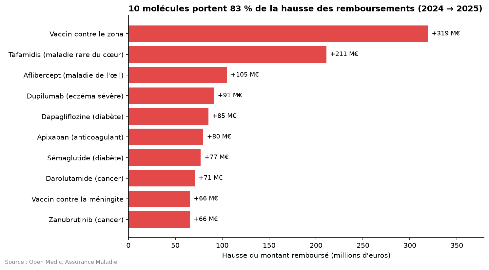
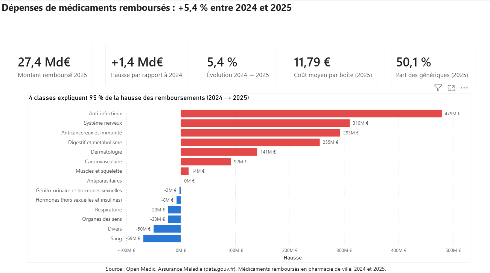
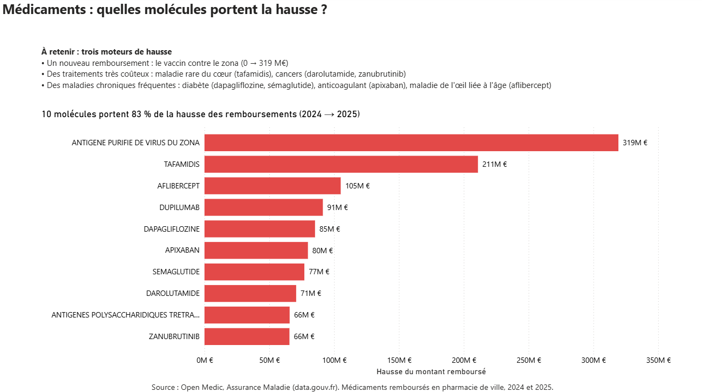
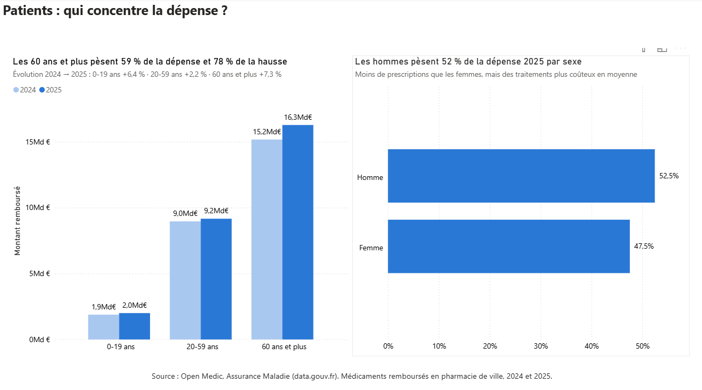
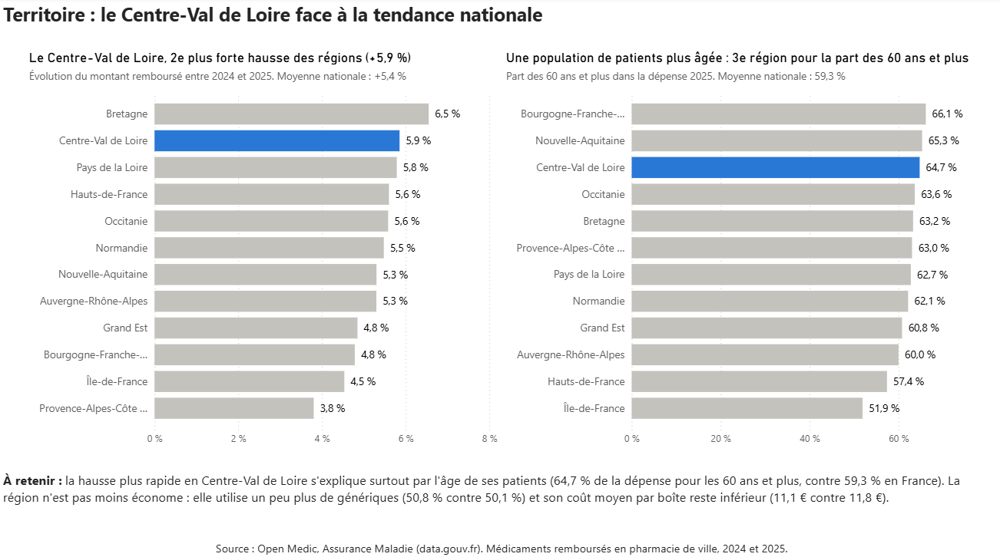

# Dépenses de médicaments remboursés : pourquoi augmentent-elles alors que l'on consomme moins de boîtes ?

Analyse des médicaments remboursés en pharmacie de ville en France entre 2024 et 2025, à partir des données ouvertes de l'Assurance Maladie (Open Medic), avec un focus sur la région Centre-Val de Loire.

**Auteure :** Fatima-Zahra FRINDOU

---

## Question métier
Pourquoi les dépenses de médicaments remboursés augmentent-elles entre 2024 et 2025, alors que le nombre de boîtes baisse ?

## Chiffres clés
| Indicateur | 2024 | 2025 | Évolution |
|---|---|---|---|
| Montant remboursé | 26,0 Md€ | 27,4 Md€ | **+5,4 %** (+1,4 Md€) |
| Nombre de boîtes | 2,37 milliards | 2,33 milliards | **−1,7 %** |
| Coût moyen par boîte | 10,99 € | 11,79 € | **+7,3 %** |
| Part des génériques (en boîtes) | 49,3 % | 50,1 % | +0,8 point |

## Principaux résultats
- **La hausse ne vient pas d'une consommation plus forte, mais de traitements plus chers :** le nombre de boîtes baisse, le coût moyen par boîte augmente.
- **Une hausse très concentrée :** 4 classes de médicaments expliquent 95 % de la hausse, et 10 molécules à elles seules 83 %.
- **Trois moteurs distincts :** un nouveau remboursement (le vaccin contre le zona, de 0 à 319 M€), des traitements innovants très coûteux (maladie rare du cœur, cancers) et des maladies chroniques fréquentes (diabète, anticoagulants).
- **Une dépense liée à l'âge :** les 60 ans et plus représentent 59 % de la dépense et portent 78 % de la hausse.
- **Le Centre-Val de Loire progresse un peu plus vite que la France** (+5,9 % contre +5,4 %), principalement parce que sa population de patients est plus âgée (64,7 % de la dépense pour les 60 ans et plus, 3e région de France). La région utilise pourtant un peu plus de génériques et son coût moyen par boîte reste inférieur à la moyenne.



## Recommandations
- **Suivre une liste courte de molécules :** 10 molécules portent 83 % de la hausse ; un suivi ciblé permettrait de détecter tôt les dérives.
- **Anticiper le coût des nouveaux remboursements :** le vaccin contre le zona représente 319 M€ dès sa première année.
- **Poursuivre le développement des génériques :** leur part progresse, mais trop lentement pour compenser la hausse.
- **Intégrer le vieillissement dans les prévisions régionales :** en Centre-Val de Loire, la dépense devrait continuer à croître plus vite que la moyenne.

## Tableau de bord Power BI
Quatre pages, une par question : vue d'ensemble, médicaments, patients, territoire.






## Démarche
1. **Chargement et découverte** des deux fichiers (3,8 millions de lignes) : séparateur, encodage, formats des montants, codes « inconnus ».
2. **Contrôles qualité** : valeurs négatives, doublons, totaux de référence.
3. **Cadrage** : question métier, sous-questions, indicateurs et hypothèses.
4. **Préparation** : sélection des colonnes, assemblage des deux années, libellés lisibles.
5. **Analyse** par médicament, par profil de patient et par région, avec un graphique et une conclusion métier pour chaque partie.
6. **Validation** des chiffres clés dans trois outils : Pandas, SQL (DuckDB) et Power BI donnent des résultats identiques.
7. **Export** de deux tableaux résumés pour Power BI, puis construction du tableau de bord.

## Cadre de l'étude et points de vigilance
- Seuls les médicaments délivrés en **pharmacie de ville** sont couverts (pas l'hôpital).
- Les données ne donnent **pas de nombre de patients** : le coût par patient ne peut pas être calculé.
- Certains codes sont **interprétés** et restent à confirmer avec le descriptif officiel (statut générique, région code 5, tranches d'âge).
- La part des génériques est calculée sur **tous** les médicaments, y compris ceux sans générique : ce n'est pas le taux officiel de substitution.
- Certaines valeurs sont **masquées** pour protéger l'anonymat des patients (4 % de la dépense n'est rattachée à aucune région).
- Les **spécialités des prescripteurs** ne sont pas analysées : leurs codes ont changé entre 2024 et 2025.
- **Deux années seulement** : les tendances sont à confirmer sur une période plus longue.

## Outils
Python (Pandas, NumPy, Matplotlib) · SQL (DuckDB) · Power BI · Git / GitHub · VS Code

## Structure du projet
```
Projet-open-medic/
├── data/
│   ├── raw/        ← fichiers bruts (non publiés, voir data/README.md)
│   └── clean/      ← tableaux résumés exportés pour Power BI
├── notebooks/
│   └── analyse.ipynb   ← analyse complète
├── sql/            ← requêtes de validation
├── powerbi/        ← tableau de bord (.pbix)
├── images/         ← graphiques et captures du tableau de bord
├── requirements.txt
└── README.md
```

## Reproduire l'analyse
1. Télécharger les fichiers 2024 et 2025 (voir [data/README.md](data/README.md)) et les placer dans `data/raw/`.
2. Créer l'environnement et installer les bibliothèques :
   ```
   python -m venv .venv
   .venv\Scripts\activate
   pip install -r requirements.txt
   ```
3. Ouvrir `notebooks/analyse.ipynb` et exécuter toutes les cellules.

## Source
[Open Medic : base complète sur les dépenses de médicaments interrégimes](https://www.data.gouv.fr/datasets/open-medic-base-complete-sur-les-depenses-de-medicaments-interregimes), Assurance Maladie, data.gouv.fr, licence ouverte (Etalab).